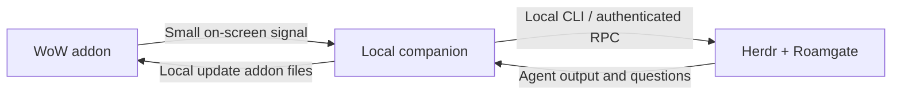

# Roamgate for WoW Forever

**Your work, within Azeroth.** A native WoW interface for your local
[Roamgate](https://github.com/powerfooI/roamgate) and [Herdr](https://herdr.dev)
conversations, plus a separate Adventurer's Grimoire for character and quest help.

**Alpha · Linux / Hyprland / Wine · MIT**

This is an independent community integration. It uses WoW's spellbook textures,
gold trim and gryphon ornaments to make your agents feel at home in the game.
It requires a local companion program as well as the addon.

## What it does

- Browse workspaces and chats, read live terminals, and send tasks to your agents.
- Review questions and permissions in game, with a separate deliberate confirmation.
- Read files and diffs through Roamgate; keep track of activity in a compact HUD.
- Create new Codex or Claude chats with a chosen model, without changing provider
  defaults or existing conversations. Hermes/OpenCode use their installed defaults.
- Ask the Adventurer's Grimoire about quests, equipment, travel and your character.
  Attach readable character/quest details when you send, and revisit earlier chats.
- Use **Alt+R** to minimize/restore both books, or open them independently from
  the HUD and minimap. **`/rg`** opens work; **`/rgg`** opens the guide.

## Supported alpha setup

| Component | Current scope |
| --- | --- |
| Game | WoW Forever 1.60.1, interface 16001; tested build 70862 |
| Desktop | Linux, Hyprland/Wayland, Wine/XWayland; `hyprctl` and `grim` |
| Agent host | Local Herdr and Roamgate, already configured and running |
| Tested integration | Herdr 0.9.1 / protocol 22; Roamgate 0.8.15 |
| Runtime | Node.js 22+, npm; systemd user services or a foreground companion |
| Validation | Lua 5.1 and `systemd-analyze` for `npm run check` |

Windows, macOS, other desktop compositors, other WoW clients and remote Herdr
machines are **not supported by this alpha's capture adapter**. Newer upstream
versions may work but need checking. Having Roamgate installed alone does not
make those platforms supported here.

## Set it up yourself

Read the [full setup guide](docs/SETUP.md) if Herdr/Roamgate are not already working.
Once they are, clone or download this repository, open a terminal in its folder,
and run:

```bash
npm ci --ignore-scripts
npm run check

# Replace this with the actual path in your Wine/Lutris/Bottles installation.
WOW_ADDONS="/absolute/path/to/World of Warcraft/_forever_/Interface/AddOns"

# Review the destination and settings; this command changes nothing.
node scripts/install.mjs --addon-dir "$WOW_ADDONS" --service

# Install and start only this addon's companion.
node scripts/install.mjs --addon-dir "$WOW_ADDONS" --install --service
```

Fully restart WoW **once after the first install** so it discovers the update
addons. Enable **Roamgate** and all **Roamgate update** entries at character
selection. Open `/rg`, keep WoW focused, and wait for **Connected to this machine**.
The [first-use checks](docs/SETUP.md#first-launch) explain how to verify delivery.

Ordinary updates use `/reload`; adding/changing update slots needs a full relaunch.
Keep the source checkout in place: the companion runs from it.

## Have your agent set it up

Give your coding agent this prompt from the cloned repository:

> Set up Roamgate for WoW Forever from this checkout. Read AGENTS.md and
> docs/AGENT_SETUP.md first. Check that my desktop and game build are supported,
> locate my actual Interface/AddOns directory, and inspect my existing Herdr and
> Roamgate setup without printing credentials. Follow docs/SETUP.md, run the
> checks, review the installer plan, and install the addon and its companion.
> Preserve my running agents and provider settings. Do not send test prompts or
> approve agent questions on my behalf. Tell me exactly when to restart WoW or
> use /reload and what I should test in game.

The [agent setup guide](docs/AGENT_SETUP.md) includes discovery steps, boundaries,
success criteria and a handoff checklist. No workstation-specific tracker or
`dev-session` installation is required.

## How it connects



WoW addons cannot open normal network connections. The companion reads the
addon's small signal strip while WoW is focused, then writes local update files
that the addon loads. It does not inject game input or read game memory.
The 2,048 default update slots are refreshed by `/reload` when used up.

## Documentation

- [Setup, updates and removal](docs/SETUP.md)
- [Agent-assisted setup](docs/AGENT_SETUP.md)
- [Using the two books, models, HUD and questions](docs/USAGE.md)
- [Troubleshooting](docs/TROUBLESHOOTING.md)
- [Architecture and porting boundaries](docs/ARCHITECTURE.md)
- [Contributing](CONTRIBUTING.md) · [Privacy and security](SECURITY.md)
- [Changelog](CHANGELOG.md) · [Verification history](docs/verification.md)

## Alpha limits and privacy

This controls real agent sessions on your machine. Messages use your existing
provider account and normal usage limits. Model availability depends on that
account; **Installed default** is available if a listed model is unavailable.
Question input checks the current target and screen, but there is no transactional
lock against another controller answering the same question simultaneously.

Conversation snapshots and drafts are local plaintext. Keep `.local-data`, WoW's
`WTF`/SavedVariables, logs and private screenshots out of public reports.
The Grimoire sends a character snapshot only when you submit with context enabled;
it omits protected game values and does not collect game chat or bag contents.
See [SECURITY.md](SECURITY.md) for the data boundaries.

## License and acknowledgements

Code is [MIT licensed](LICENSE). Liberation Mono is bundled under its
[SIL Open Font License](addon/Roamgate/Media/FONT-LICENSE.txt).
WoW supplies its textures at runtime; no Blizzard artwork is distributed here.

Built on Roamgate and Herdr. The local optical transport was inspired by
[T3 WoW](https://www.curseforge.com/wow/addons/t3-wow); this is an independent
implementation with no T3 source or images. See [third-party notices](THIRD_PARTY_NOTICES.md).
